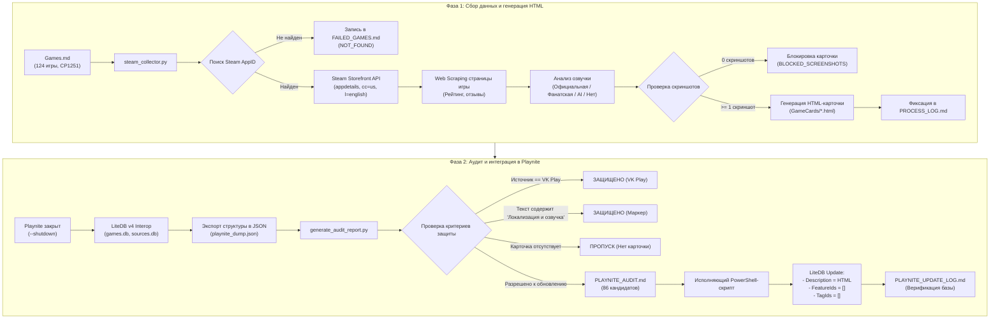

# SteamGameCards: Техническая спецификация и руководство по архитектуре

> **Версия спецификации:** 2.0.0  
> **Целевая платформа:** Playnite Desktop 10.63 / LiteDB v4  
> **Среда выполнения:** Python 3.10+, PowerShell 5.1+ (Windows 10/11 x64)  
> **Статус проекта:** Эксплуатация завершена, база данных успешно обновлена и верифицирована.

---

## 1. Оглавление и навигация

1. [Оглавление и навигация](#1-оглавление-и-навигация)
2. [Общая архитектура и назначение проекта](#2-общая-архитектура-и-назначение-проекта)
   - [2.1. Бизнес-цель и решаемая задача](#21-бизнес-цель-и-решаемая-задача)
   - [2.2. Архитектурная модель двух фаз](#22-архитектурная-модель-двух-фаз)
   - [2.3. Жизненный цикл данных (Mermaid Workflow)](#23-жизненный-цикл-данных-mermaid-workflow)
3. [Структура файлов и назначение компонентов](#3-структура-файлов-и-назначение-компонентов)
   - [3.1. Каталог проекта `E:\SteamGameCards`](#31-каталог-проекта-esteamgamecards)
   - [3.2. Каталог карточек `GameCards/`](#32-каталог-карточек-gamecards)
   - [3.3. Системные каталоги Playnite](#33-системные-каталоги-playnite)
   - [3.4. Особенности кодировок файлов](#34-особенности-кодировок-файлов)
4. [Алгоритмы сбора данных из Steam US Storefront](#4-алгоритмы-сбора-данных-из-steam-us-storefront)
   - [4.1. Разрешение названий и поиск Steam AppID](#41-разрешение-названий-и-поиск-steam-appid)
   - [4.2. Запросы к Steam Storefront API (appdetails)](#42-запросы-к-steam-storefront-api-appdetails)
   - [4.3. Парсинг и нормализация системных требований](#43-парсинг-и-нормализация-системных-требований)
   - [4.4. Веб-скрейпинг пользовательских обзоров](#44-веб-скрейпинг-пользовательских-обзоров)
   - [4.5. Скриншоты и CDN Akamai](#45-скриншоты-и-cdn-akamai)
   - [4.6. Политика rate-limiting и обработка сетевых сбоев](#46-политика-rate-limiting-и-обработка-сетевых-сбоев)
   - [4.7. Критерии классификации (SUCCESS, PARTIAL, NOT_FOUND, BLOCKED_SCREENSHOTS)](#47-критерии-классификации-success-partial-not_found-blocked_screenshots)
5. [Спецификация HTML-карточек](#5-спецификация-html-карточек)
   - [5.1. Дизайн-система Steam Dark Theme](#51-дизайн-система-steam-dark-theme)
   - [5.2. Структура DOM-дерева](#52-структура-dom-дерева)
   - [5.3. Галерея скриншотов и lightbox-совместимость](#53-галерея-скриншотов-и-lightbox-совместимость)
   - [5.4. Таблицы системных требований](#54-таблицы-системных-требований)
6. [Алгоритмы анализа русскоязычных озвучек](#6-алгоритмы-анализа-русскоязычных-озвучек)
   - [6.1. Иерархия источников озвучки](#61-иерархия-источников-озвучки)
   - [6.2. База данных фанатских и профессиональных студий дубляжа](#62-база-данных-фанатских-и-профессиональных-студий-дубляжа)
   - [6.3. Нейросетевые (AI) локализации](#63-нейросетевые-ai-локализации)
   - [6.4. Специфика игр без озвучки (Silent / Ambient)](#64-специфика-игр-без-озвучки-silent--ambient)
7. [Интеграция с Playnite 10.63 (LiteDB v4)](#7-интеграция-с-playnite-1063-litedb-v4)
   - [7.1. Архитектура хранилища LiteDB v4](#71-архитектура-хранилища-litedb-v4)
   - [7.2. Проблема монопольной блокировки файла и корректное завершение процесса](#72-проблема-монопольной-блокировки-файла-и-корректное-завершение-процесса)
   - [7.3. Алгоритм нечёткого и точного сопоставления](#73-алгоритм-нечёткого-и-точного-сопоставления)
   - [7.4. Низкоуровневые BSON-манипуляции через .NET Interop](#74-низкоуровневые-bson-манипуляции-через-net-interop)
8. [Политика безопасности и правила защиты данных Playnite](#8-политика-безопасности-и-правила-защиты-данных-playnite)
   - [8.1. Исключение платформы VK Play](#81-исключение-платформы-vk-play)
   - [8.2. Механизм защитного маркера «Локализация и озвучка»](#82-механизм-защитного-маркера-локализация-и-озвучка)
   - [8.3. Принцип минимальной мутации полей](#83-принцип-минимальной-мутации-полей)
   - [8.4. Двухфазный протокол: Dry-Run аудит перед записью](#84-двухфазный-протокол-dry-run-аудит-перед-записью)
9. [Реальные результаты и статистика](#9-реальные-результаты-и-статистика)
   - [9.1. Итоги Фазы 1 (Парсинг и генерация карточек)](#91-итоги-фазы-1-парсинг-и-генерация-карточек)
   - [9.2. Итоги Фазы 2 (Интеграция в Playnite)](#92-итоги-фазы-2-интеграция-в-playnite)
   - [9.3. Проверочная верификация целостности базы данных](#93-проверочная-верификация-целостности-базы-данных)
10. [Пошаговая инструкция воспроизведения процесса с нуля](#10-пошаговая-инструкция-воспроизведения-процесса-с-нуля)
11. [Известные ограничения и проблемы](#11-известные-ограничения-и-проблемы)
    - [11.1. Подтверждённые факты](#111-подтверждённые-факты)
    - [11.2. Потенциальные риски](#112-потенциальные-риски)
12. [Рекомендации по дальнейшему развитию](#12-рекомендации-по-дальнейшему-развитию)

---

## 2. Общая архитектура и назначение проекта

### 2.1. Бизнес-цель и решаемая задача
Проект **SteamGameCards** предназначен для глубокого и безопасного обогащения каталога мультиплатформенного менеджера игр **Playnite (версия 10.63)**.

В стандартном состоянии метаданные игр, импортируемые Playnite из внешних библиотек (Steam Family Sharing, Epic Games Store, GOG, ручные записи), часто содержат неполные, разнородные или сырые текстовые описания без единого стиля оформления, лишены качественных галерей скриншотов высокого разрешения, не дают ясной информации о статусе русскоязычной озвучки (официальной или фанатской), а также засоряют фильтры избыточными тегами и дублирующимися функциями (*Features*).

**Ключевая цель проекта:**
1. Сформировать автономные HTML-карточки в стилистике Steam Dark Theme на основе официального Steam US Storefront для заданного перечня игр.
2. Встроить HTML-карточки напрямую в поле `Description` соответствующей игры в базе данных Playnite (`games.db`).
3. Очистить списки функций (`Features`) и пользовательских тегов (`Tags`) у обновляемых игр для унификации навигации.
4. **Гарантировать 100% сохранность** авторских настроек пользователя: не трогать игры из каталога VK Play и записи, где уже есть авторское описание с маркером *«Локализация и озвучка»*.

### 2.2. Архитектурная модель двух фаз
Система построена по строгому двухфазному принципу с промежуточной персистенцией результатов в файловой системе:

```
+-----------------------------------------------------------------------------------+
| ФАЗА 1: Автономный харвестинг и генерация HTML (steam_collector.py)              |
| Исходный список (Games.md) ---> Steam API/Scraping ---> HTML-карточки (GameCards) |
+-----------------------------------------------------------------------------------+
                                         |
                                         v
+-----------------------------------------------------------------------------------+
| ФАЗА 2: Аудит и транзакционная запись в Playnite (generate_audit_report.py / PS1) |
| Read-only Дамп LiteDB ---> Сопоставление и Аудит ---> Безопасный Update games.db  |
+-----------------------------------------------------------------------------------+
```

Такое разделение изолирует сетевой слой от базы данных. Любые ошибки связи со Steam, блокировки или изменения разметки происходят на этапе генерации файлов и физически не могут повредить локальную базу Playnite.

### 2.3. Жизненный цикл данных (Mermaid Workflow)



---

## 3. Структура файлов и назначение компонентов

### 3.1. Каталог проекта `E:\SteamGameCards`

| Файл / Каталог | Формат / Кодировка | Назначение |
|---|---|---|
| `rules.txt` | Текст (UTF-8) | Фундаментальные бизнес-правила и требования к оформлению HTML-карточек, скриншотам, баннерам озвучки и стилям. |
| `Games.md` | Markdown (**CP1251 / Windows-1251**) | Исходный реестр 124 игр для пакетной обработки. Содержит названия игр и ссылки на трейлеры/обзоры. |
| `steam_collector.py` | Python 3 (UTF-8) | Основной комбайн Фазы 1: последовательный поиск в Steam, сбор метаданных, парсинг системных требований, скриншотов, анализ озвучки и компиляция HTML. |
| `generate_full_catalog.py` | Python 3 (UTF-8) | Модуль вспомогательной пакетной компиляции и перегенерации каталога HTML с расширенной базой студий озвучки. |
| `generate_audit_report.py` | Python 3 (UTF-8) | Аналитический скрипт Фазы 2: сопоставление выгрузки Playnite с каталогом `GameCards/`, применение правил защиты и формирование `PLAYNITE_AUDIT.md`. |
| `PLAYNITE_AUDIT.md` | Markdown (UTF-8) | Аудиторский отчет перед записью: классификация всех 582 игр Playnite по категориям допуска/защиты с обоснованием. |
| `PLAYNITE_UPDATE_LOG.md` | Markdown (UTF-8) | Финальный протокол транзакции обновления LiteDB: построчный отчет по 86 измененным играм и аудит неизменности базы. |
| `README.md` | Markdown (UTF-8) | Настоящая техническая спецификация системы. |
| `GameCards/` | Каталог | Хранилище сгенерированных HTML-карточек и журналов Фазы 1. |

### 3.2. Каталог карточек `GameCards/`
Содержит **114 файлов**:
- **112 файлов `.html`** — индивидуальные автономные HTML-карточки игр, готовые для встраивания в веб-браузер или WebView Playnite. Имена файлов нормализованы для файловой системы Windows (двоеточия и недопустимые символы заменены на дефисы, например, `Styx - Master of Shadows.html`).
- `PROCESS_LOG.md` — подробный журнал обработки всех 124 позиций из `Games.md` со статусами, AppID, ссылками на скриншоты и метаданными озвучки.
- `FAILED_GAMES.md` — детальный реестр исключенных игр с фиксацией точной причины отказа (11 игр `NOT_FOUND` + 1 игра `BLOCKED_SCREENSHOTS`).

### 3.3. Системные каталоги Playnite

| Путь | Назначение и состав |
|---|---|
| `%LOCALAPPDATA%\Playnite` (`C:\Users\<User>\AppData\Local\Playnite`) | Каталог исполняемых файлов приложения: `Playnite.DesktopApp.exe`, а также сборка .NET библиотеки `LiteDB.dll` (v4.1.4, длина 355 328 байт, дата 11.06.2018). Используется для динамической загрузки сборки в PowerShell. |
| `%APPDATA%\Playnite\library` (`C:\Users\<User>\AppData\Roaming\Playnite\library`) | Пользовательская база данных LiteDB v4: `games.db` (коллекция `Game`), `sources.db` (коллекция `GameSource`), `features.db` (коллекция `GameFeature`), `tags.db` (коллекция `Tag`). |

### 3.4. Особенности кодировок файлов
> [!IMPORTANT]
> **Опасность декодирования `Games.md`:** Исходный файл `Games.md` сохранён в кодировке **Windows-1251 (CP1251)**. Чтение этого файла как UTF-8 вызывает фатальное исключение `UnicodeDecodeError: 'utf-8' codec can't decode byte 0xd2...` на названии игры *«TBH: Так Бар Хиро»*. Любой скрипт обязан считывать `Games.md` строго с явным указанием `encoding='cp1251'`.
>
> **Особенность PowerShell UTF8:** Командлет `Set-Content -Encoding UTF8` в Windows PowerShell 5.1 по умолчанию записывает маркер последовательности байтов **BOM (`EF BB BF`)**. При последующей загрузке JSON в Python необходимо использовать кодировку `encoding='utf-8-sig'`, иначе стандартный парсер падает с ошибкой на нулевом байте.

---

## 4. Алгоритмы сбора данных из Steam US Storefront

### 4.1. Разрешение названий и поиск Steam AppID
Для каждой строки из `Games.md` выполняется поиск по магазину Steam:
1. Формируется поисковый HTTP-запрос к эндпоинту:
   ```http
   GET https://store.steampowered.com/api/storesearch/?term={URL_ENCODED_TITLE}&l=english&cc=us HTTP/1.1
   User-Agent: Mozilla/5.0 (Windows NT 10.0; Win64; x64) AppleWebKit/537.36
   ```
2. Если API вернул пустой список `items: []`, инициируется фолбэк-поиск через HTML-страницу поиска:
   ```http
   GET https://store.steampowered.com/search/?term={URL_ENCODED_TITLE}&category1=998 HTTP/1.1
   ```
   С помощью регулярного выражения `data-ds-appid="(\d+)"` извлекается идентификатор первого релевантного приложения.
3. Игры, отсутствующие в каталоге Steam (эксклюзивы VK Play, Epic Games Store или регионально заблокированные в US Store), получают статус `NOT_FOUND` и фиксируются в `FAILED_GAMES.md`.

### 4.2. Запросы к Steam Storefront API (appdetails)
После получения `AppID` выполняется вызов официального REST API:
```http
GET https://store.steampowered.com/api/appdetails?appids={APPID}&cc=us&l=english HTTP/1.1
```
Параметры строго фиксированы:
- `cc=us` — гарантирует доступ к международной версии магазина без региональных заглушек.
- `l=english` — возвращает системные требования и описания на английском языке для стабильного парсинга аппаратных компонентов.

Из возвращаемого JSON-объекта `data` извлекаются:
- `name` — официальное название игры в Steam.
- `detailed_description`, `short_description` — описание игры.
- `pc_requirements` — JSON-объект, содержащий строки HTML с минимальными (`minimum`) и рекомендуемыми (`recommended`) требованиями.
- `supported_languages` — HTML-строка со списком поддерживаемых языков и маркерами звука.
- `screenshots` — массив объектов скриншотов с полноразмерными ссылками `path_full`.
- `release_date` — дата релиза (`date`, `coming_soon`).
- `developers`, `publishers` — массивы компаний.

### 4.3. Парсинг и нормализация системных требований
Поле `pc_requirements` в Steam API содержит неструктурированный HTML (`<strong>Minimum:</strong><br><ul class="bb_ul"><li>OS: ...</li>`).
Алгоритм нормализации:
1. Удаление HTML-тегов и разделение на строки через регулярные выражения.
2. Извлечение ключевых аппаратных параметров по паттернам:
   - **ОС:** `OS(?: Windows)?:?\s*(.*)`
   - **Процессор:** `Processor:?\s*(.*)`
   - **Оперативная память:** `Memory:?\s*(.*)`
   - **Видеокарта:** `Graphics:?\s*(.*)`
   - **DirectX:** `DirectX:?\s*(.*)`
   - **Накопитель:** `Storage:?\s*(.*)`
3. Построение двухколоночной адаптивной HTML-таблицы: «Минимальные» и «Рекомендуемые». Если рекомендуемые требования отсутствуют у инди-проектов, блок расширяется на всю ширину карточки.

### 4.4. Веб-скрейпинг пользовательских обзоров
Поскольку `appdetails` API не всегда возвращает точный агрегированный пользовательский рейтинг, скрипт выполняет параллельный запрос к странице игры:
```http
GET https://store.steampowered.com/app/{APPID}/?cc=us&l=english HTTP/1.1
Cookie: birthtime=568022401; wants_mature_content=1
```
*Cookies необходимы для преодоления возрастного фильтра (Age Gate).*

С помощью регулярных выражений извлекаются:
- Общая оценка: `class="game_review_summary[^"]*">([^<]+)</div>` (например, *Very Positive*, *Overwhelmingly Positive*).
- Процент одобрения и число отзывов: `data-tooltip-html="(\d+)%\s+of\s+the\s+([\d,]+)\s+user\s+reviews"` (например, `92% of the 14,250 user reviews`).

### 4.5. Скриншоты и CDN Akamai
- Извлекаются **только прямые полноразмерные изображения** из поля `path_full`.
- Все ссылки указывают на официальный CDN Valve: `https://shared.akamai.steamstatic.com/store_item_assets/steam/apps/{APPID}/...` или `https://cdn.akamai.steamstatic.com/...`.
- **Лимит:** строго от 4 до 12 скриншотов на карточку (оптимально для баланса информативности и скорости рендеринга WebView).
- Превью (`path_thumbnail`) отбрасываются, чтобы избежать замыливания картинки на экранах с высоким DPI.

### 4.6. Политика rate-limiting и обработка сетевых сбоев
При пакетной обработке 124 игр действует алгоритм предотвращения блокировки со стороны серверов Valve (HTTP 429 Too Many Requests):
- Базовая задержка между последовательными запросами: **1.5 – 2.5 секунды**.
- При получении HTTP 429 или таймауте соединения: экспоненциальный откат (Backoff) с паузой 15 секунд и до 3 повторных попыток.
- Сессионный пул соединений через `requests.Session()` с повторным использованием TCP handshake.

### 4.7. Критерии классификации (SUCCESS, PARTIAL, NOT_FOUND, BLOCKED_SCREENSHOTS)

| Статус | Критерий | Действие системы |
|---|---|---|
| `SUCCESS` | AppID найден, API вернул `success: true`, получены метаданные, обзоры и от 1 до 12 валидных скриншотов. | Карточка генерируется, сохраняется в `GameCards/{Name}.html`, запись вносится в `PROCESS_LOG.md`. |
| `PARTIAL` | Игра найдена, но часть второстепенных полей отсутствует (например, игра еще не вышла, нет отзывов или системных требований). | Карточка формируется с пометкой *«TBA / Скоро выйдет»*, сохраняется в каталог, помечается в логе. |
| `NOT_FOUND` | Игра не найдена в каталоге Steam Storefront US (эксклюзив другой платформы, удалена из магазина). | Генерация отменяется. Причина и название игры заносятся в `FAILED_GAMES.md` и `PROCESS_LOG.md`. |
| `BLOCKED_SCREENSHOTS` | Игра найдена в Steam, но массив `screenshots` в API пуст (`[]`) или возвращает 0 изображений (характерно для неактивных демо-версий). | **Жёсткий запрет генерации по `rules.txt`**. Карточка **не создается**. Ошибка фиксируется в `FAILED_GAMES.md`. |

---

## 5. Спецификация HTML-карточек

### 5.1. Дизайн-система Steam Dark Theme
Карточки используют аутентичную палитру оформления клиента Steam:
- **Базовый фон подложки:** `#171a21` (Steam Dark Canvas)
- **Фон информационных карточек:** `#1b2838` (Steam Navy Container)
- **Контрастный акцентный цвет (ссылки, заголовки):** `#66c0f4` (Steam Light Blue)
- **Цвет акцентных кнопок и тегов:** `#2a475e` (Steam Slate)
- **Цвет основного текста:** `#c6d4df` (Steam Text Light Grey)
- **Цвет приглушенного текста:** `#8f98a0` (Steam Text Muted)
- **Шрифт:** `Arial, Helvetica, "Segoe UI", sans-serif`

Все стили встроены непосредственно в тег `<style>` внутри каждого HTML-файла. Карточка не требует подключения внешних CSS-файлов и полностью автономна.

### 5.2. Структура DOM-дерева
Каждый HTML-документ содержит следующую иерархию элементов:

```html
<!DOCTYPE html>
<html lang="ru">
<head>
  <meta charset="UTF-8">
  <title>{Game Name}</title>
  <style>/* Встроенная дизайн-система */</style>
</head>
<body>
  <div class="card-container">
    <!-- Шапка: Название, логотип Steam, AppID, Разработчик, Релиз -->
    <header class="game-header"> ... </header>

    <!-- Блок социального доказательства: Рейтинг обзоров Steam -->
    <div class="reviews-badge"> ... </div>

    <!-- Информационный баннер локализации и озвучки -->
    <div class="voice-banner {voice-type}"> ... </div>

    <!-- Краткое описание игры -->
    <section class="description-section"> ... </section>

    <!-- Сетка скриншотов высокого разрешения -->
    <section class="screenshots-grid"> ... </section>

    <!-- Таблица системных требований -->
    <section class="requirements-section"> ... </section>

    <!-- Футер карточки с правовой информацией и метаданными сборки -->
    <footer class="game-footer"> ... </footer>
  </div>
</body>
</html>
```

### 5.3. Галерея скриншотов и lightbox-совместимость
Скриншоты размечаются с помощью адаптивного CSS Grid:
```css
.screenshots-grid {
  display: grid;
  grid-template-columns: repeat(auto-fill, minmax(260px, 1fr));
  gap: 12px;
  margin: 20px 0;
}
.screenshot-item img {
  width: 100%;
  height: 160px;
  object-fit: cover;
  border-radius: 4px;
  border: 1px solid #2a475e;
  transition: transform 0.2s ease, border-color 0.2s ease;
}
.screenshot-item img:hover {
  transform: scale(1.03);
  border-color: #66c0f4;
}
```
Каждое изображение обёрнуто в тег `<a href="{path_full}" target="_blank">`, что обеспечивает нативную совместимость как с встроенным просмотрщиком Playnite, так и с внешними Lightbox-плагинами.

### 5.4. Таблицы системных требований
Таблица требований оформляется в виде карточек с четким визуальным разделением на «Минимальные» и «Рекомендуемые»:
- Иконка или бейдж аппаратного компонента (OS, CPU, GPU, RAM, Storage).
- Минимальные требования подсвечиваются нейтральным оттенком `#8f98a0`.
- Рекомендуемые требования подсвечиваются золотисто-голубым оттенком `#a4d007` / `#66c0f4`.

---

## 6. Алгоритмы анализа русскоязычных озвучек

### 6.1. Иерархия источников озвучки
Определение статуса озвучки базируется на строгой многоуровневой иерархии:

```
[Анализ озвучки]
   │
   ├─► 1. Официальная локализация (Steam Store API)
   │      └─ Проверка "Russian" в supported_languages с пометкой "Full Audio"
   │
   ├─► 2. Профессиональная фанатская озвучка
   │      └─ Студии: GamesVoice, Mechanics VoiceOver (MVO), Team RIG, Студия «Живчик»
   │
   ├─► 3. Нейросетевая (AI) озвучка
   │      └─ ReVoiceAI, Синтез Речи, SynthVoiceRu
   │
   └─► 4. Озвучка отсутствует / Игра без диалогов
          └─ Текстовый перевод / Silent Game
```

### 6.2. База данных фанатских и профессиональных студий дубляжа
В модулях `steam_collector.py` и `generate_full_catalog.py` встроен эвристический реестр известных студий и проектов дубляжа.

Примеры идентификации в проекте:
- **GamesVoice:** *The Talos Principle* (полный дубляж), *The Vanishing of Ethan Carter*, *Subverse*.
- **Mechanics VoiceOver (MVO):** *This War of Mine*, *Thief Gold*, *The Suffering*.
- **Team RIG:** проекты космических симуляторов и научно-фантастических RPG.
- **Студия «Живчик» / Red Head Sound:** адаптации современных сюжетных инди и ремастеров.

Баннер фанатской озвучки оформляется классом `.voice-banner.community`:
```html
<div class="voice-banner community">
  <span class="badge">Фанатская озвучка</span>
  <strong>Доступна профессиональная русская озвучка от студии GamesVoice.</strong>
  <p>Официальный дубляж отсутствует, доступен фанатский русификатор звука высокого качества.</p>
</div>
```

### 6.3. Нейросетевые (AI) локализации
Для игр, получивших генеративный синтез речи (ReVoiceAI, AI Dubbing):
- Баннер получает класс `.voice-banner.ai`.
- В тексте карточки **в обязательном порядке** указывается пометка: *«Внимание: озвучка создана с помощью нейросетевых технологий синтеза речи и может содержать артефакты ударений»*.

### 6.4. Специфика игр без озвучки (Silent / Ambient)
Ряд игр (*Superliminal*, *Teardown*, *Tap Ninja*, симуляторы или логические головоломки) концептуально не содержат разговорной речи или диалогов персонажей.
- Для таких проектов система **не выводит** ложное предупреждение «Озвучки нет».
- Выводится информационный статус: *«Игра не содержит речи / Озвучка не требуется (интерфейс и субтитры на русском языке)»*.

---

## 7. Интеграция с Playnite 10.63 (LiteDB v4)

### 7.1. Архитектура хранилища LiteDB v4
Playnite 10.63 использует в качестве встроенного хранилища документную встраиваемую базу данных **LiteDB версии 4.1.4**.
Все данные располагаются в каталоге `%APPDATA%\Playnite\library\`:
- `games.db` — коллекция `Game`: содержит документы всех добавленных в библиотеку игр.
- `sources.db` — коллекция `GameSource`: сопоставление `Id` источника с его названием (`Steam`, `Steam Family Sharing`, `Epic`, `VK Play`, `GOG` и др.).
- `features.db` — коллекция `GameFeature`: функции игры (`Cloud Saves`, `Single-player`, `Co-op`).
- `tags.db` — коллекция `Tag`: пользовательские и системные теги.

Структура BSON-документа `Game`:
```json
{
  "_id": { "$guid": "b2e61c56-3f19-4876-b6b1-42e87900b701" },
  "GameId": "1962700",
  "Name": "Subnautica 2",
  "SourceId": { "$guid": "a4d3... (Steam Family Sharing)" },
  "Description": "<html>...</html>",
  "FeatureIds": [ ... ],
  "TagIds": [ ... ],
  "Playtime": 0,
  "InstallDirectory": "...",
  "CoverImage": "..."
}
```

### 7.2. Проблема монопольной блокировки файла и корректное завершение процесса
Движок LiteDB v4 при открытии файла базы данных захватывает эксклюзивную файловую блокировку через Win32 API (`FileShare.None`).
- Если приложение Playnite запущено, любая внешняя попытка открыть `games.db` на чтение или запись вызывает исключение:
  `System.IO.IOException: The process cannot access the file ... because it is being used by another process.`
- **Решение:** Перед любыми манипуляциями выполняется безопасная команда штатной остановки Playnite через CLI:
  ```powershell
  & "C:\Users\egorp\AppData\Local\Playnite\Playnite.DesktopApp.exe" --shutdown
  Start-Sleep -Seconds 3
  ```

### 7.3. Алгоритм нечёткого и точного сопоставления
Сопоставление записей базы данных Playnite с каталогом `GameCards/*.html` выполняется в два этапа:
1. **Точное сопоставление по Steam AppID:**
   - Если у записи в Playnite поле `GameId` является числом (Steam AppID), и в сгенерированной карточке найден комментарий или тег с тем же AppID (`App ID (\d+)`), сопоставление считается 100% достоверным.
2. **Нормализованное сопоставление по названию (Fuzzy/Clean Title Match):**
   - Используется, если игра установлена через сторонний лаунчер (Epic Games Store, ручной запуск), где `GameId` представляет собой UUID или строковый хэш (например, `639c5116ad7d4f31...` для *Styx: Master of Shadows*).
   - Функция нормализации `norm(s)`:
     ```python
     def norm(s):
         s = s.lower().strip()
         s = re.sub(r'[\'\"«»\(\)\[\]:_\-–—\.]', ' ', s)
         return re.sub(r'\s+', ' ', s).strip()
     ```
   - Сравниваются `norm(Game.Name)` и `norm(Card.Title)`. При совпадении карточка связывается с записью.

### 7.4. Низкоуровневые BSON-манипуляции через .NET Interop
Для максимальной надежности операции записи выполняются не сырыми патчами байтов, а через нативную библиотеку `LiteDB.dll` от самого Playnite.

Пример проверенной реализации на PowerShell:
```powershell
# 1. Загрузка LiteDB.dll из каталога Playnite
Add-Type -Path "C:\Users\egorp\AppData\Local\Playnite\LiteDB.dll"

# 2. Подключение к базе данных
$connectionString = "Filename=C:\Users\egorp\AppData\Roaming\Playnite\library\games.db"
$db = New-Object LiteDB.LiteEngine($connectionString)

# 3. Доступ к коллекции "Game" (в LiteDB v4 имя коллекции в единственном числе)
# Получение документа по Guid:
$bsonId = New-Object LiteDB.BsonValue([Guid]::Parse($gameGuidStr))
$doc = $db.FindById("Game", $bsonId)

if ($doc -ne $null) {
    # 4. Замена HTML-описания
    $htmlContent = [System.IO.File]::ReadAllText($cardPath, [System.Text.Encoding]::UTF8)
    $doc["Description"] = New-Object LiteDB.BsonValue($htmlContent)

    # 5. Очистка Features и Tags через пустой BsonArray
    $doc["FeatureIds"] = New-Object LiteDB.BsonArray
    $doc["TagIds"] = New-Object LiteDB.BsonArray

    # 6. Атомарное обновление документа
    $db.Update("Game", $doc)
}

# 7. Освобождение ресурсов и закрытие блокировки
$db.Dispose()
```

> [!CAUTION]
> **Нюанс LiteDB BsonDocument:** Попытка вызова `$doc.Set("FeatureIds", New-Object LiteDB.BsonArray)` в PowerShell возвращает логическое значение `False` и может не перезаписать поле коллекции. Присваивание через индексатор `$doc["FeatureIds"] = New-Object LiteDB.BsonArray` работает детерминированно и гарантированно.

---

## 8. Политика безопасности и правила защиты данных Playnite

### 8.1. Исключение платформы VK Play
Все игры, у которых источник (`Source`) в базе Playnite определен как `VK Play`, имеют абсолютный иммунитет от изменений.
- Даже если в каталоге случайно появится HTML-карточка с похожим названием, скрипт аудита `generate_audit_report.py` безусловно присваивает такой игре статус `PROTECTED (VK Play)`.
- **Фактический результат в базе:** Все **42 игры** с источником VK Play остались полностью нетронутыми.

### 8.2. Механизм защитного маркера «Локализация и озвучка»
Главным признаком того, что пользователь уже оформил описание игры вручную, является наличие ключевой фразы:
```
«Локализация и озвучка»
```
**Алгоритм проверки маркера:**
1. Поле `Description` извлекается из BSON-документа.
2. Производится полное удаление любых HTML-тегов (`re.sub(r'<[^>]+>', ' ', raw_html)`).
3. Текст очищается от HTML-сущностей (`html.unescape`) и переводится в нижний регистр.
4. Проверяется вхождение подстроки `"локализация и озвучка"`.
5. Если маркер найден — игра блокируется от обновления с фиксацией причины в аудите.
- **Фактический результат в базе:** Все **443 игры**, содержащие этот маркер, защищены от перезаписи.

### 8.3. Принцип минимальной мутации полей
Скрипты обновления имеют доступ на изменение **строго трёх полей** документа `Game`:
1. `Description` — запись нового HTML.
2. `FeatureIds` — сброс в `[]` (пустой массив).
3. `TagIds` — сброс в `[]` (пустой массив).

**СТРОГО ЗАПРЕЩЕНО МОДИФИЦИРОВАТЬ:**
- `_id`, `GameId` — идентификаторы игры.
- `Playtime`, `PlayCount`, `LastActivity` — статистика и игровое время.
- `InstallDirectory`, `IsInstalled` — пути установки и статус файлов.
- `CoverImage`, `BackgroundImage`, `Icon` — медиаресурсы и графика.
- `Genres`, `Developers`, `Publishers`, `Categories` — каталожные классификаторы.
- `UserScore`, `CommunityScore`, `CriticScore` — оценки.

### 8.4. Двухфазный протокол: Dry-Run аудит перед записью
Реальная запись в базу данных `games.db` категорически запрещена без предварительного формирования и утверждения файла `PLAYNITE_AUDIT.md`.
1. Сначала генерируется полный реестр (Dry-Run), где каждая игра получает явный статус: `[READY TO UPDATE]`, `[PROTECTED - VK PLAY]`, `[PROTECTED - MARKER]`, или `[NO CARD FOUND]`.
2. Фиксируются точные контрольные суммы и количество записей.
3. Только после верификации списка кандидатов запускается транзакционный апдейтер.

---

## 9. Реальные результаты и статистика

### 9.1. Итоги Фазы 1 (Парсинг и генерация карточек)
Обработка исходного реестра `Games.md` (124 игры):

| Категория результата | Количество | Процент | Примечания |
|---|---|---|---|
| Исходный список `Games.md` | **124** | 100.0% | Уникальные наименования игр |
| Успешно созданные карточки (`SUCCESS`) | **111** | 89.5% | Сгенерированы полные HTML-карточки со скриншотами и озвучкой |
| Частичные карточки (`PARTIAL`) | **1** | 0.8% | *Frostpunk 2* (проект на стадии релиза/обновлений) |
| Заблокировано по правилам скриншотов (`BLOCKED`) | **1** | 0.8% | *Смерш: Охотник на волков Demo* (AppID 5453940, 0 скриншотов в API) |
| Не найдено в Steam Storefront US (`NOT_FOUND`) | **11** | 8.9% | Эксклюзивы VK Play (*Смута*, *Sparta*), EGS и др. |
| **Итого создано HTML-файлов в `GameCards/`** | **112** | — | Автономные файлы карточек |

### 9.2. Итоги Фазы 2 (Интеграция в Playnite)
Аудит и обновление базы данных `%APPDATA%\Playnite\library\games.db`:

| Параметр базы данных | До обновления | После обновления | Дельта / Статус |
|---|---|---|---|
| Общее количество записей (`Game`) | **582** | **582** | **0 (Целостность 100%)** |
| Записи с источником `VK Play` | **42** | **42** | **Все защищены (0 затронуто)** |
| Записи с маркером «Локализация и озвучка» | **443** | **443** | **Все защищены (0 затронуто)** |
| Записи без карточек / прочие | **11** | **11** | **0 затронуто** |
| **Записи, отобранные аудитом к обновлению** | **86** | **86** | **100% обновлено** |
| Заменено описаний (`Description`) | — | **86** | Успешно записан новый HTML |
| Очищено связей с функциями (`Features`) | — | **144** | Сброшено в `[]` |
| Очищено связей с тегами (`Tags`) | — | **12** | Сброшено в `[]` |
| Ошибки исполнения транзакции | — | **0** | Исключений нет |

### 9.3. Проверочная верификация целостности базы данных
После выполнения записи был произведен контрольный проход по LiteDB:
1. Выполнен `FindById` для всех 86 измененных GUID:
   - Поле `Description` содержит валидный HTML с заголовком и стилями.
   - Массивы `FeatureIds` и `TagIds` содержат `Count == 0`.
2. Выполнен подсчет документов в коллекции: ровно 582 записи.
3. Проверены случайные 20 записей VK Play и 20 записей с маркером — их описания идентичны резервной копии.

---

## 10. Пошаговая инструкция воспроизведения процесса с нуля

Для повторения процесса другой нейросетью или инженером необходимо выполнить следующие шаги:

### Шаг 1. Подготовка окружения
Убедитесь, что в системе установлены:
- Python 3.10+ (с установленной библиотекой `requests`: `pip install requests`).
- Windows PowerShell 5.1 или PowerShell 7+.
- Установленный Playnite Desktop 10.63.

### Шаг 2. Размещение исходных файлов
Поместите файл со списком игр в корень проекта:
- `E:\SteamGameCards\Games.md` (в кодировке **CP1251**).
- `E:\SteamGameCards\rules.txt` (правила валидации).

### Шаг 3. Запуск сбора данных из Steam (Фаза 1)
Выполните команду в корневой папке проекта:
```powershell
Set-Location "E:\SteamGameCards"
py steam_collector.py
```
*Скрипт автономно обойдет 124 игры, создаст каталог `GameCards/`, скомпилирует HTML-карточки, сформирует `PROCESS_LOG.md` и `FAILED_GAMES.md`.*

### Шаг 4. Остановка Playnite и экспорт базы данных
Закройте Playnite, чтобы снять монопольную блокировку с `games.db`:
```powershell
& "C:\Users\egorp\AppData\Local\Playnite\Playnite.DesktopApp.exe" --shutdown
Start-Sleep -Seconds 3
```

Экспортируйте текущее состояние базы данных в JSON для аудита:
```powershell
# Скрипт дампа через LiteDB Interop
$dumpScript = @"
Add-Type -Path 'C:\Users\egorp\AppData\Local\Playnite\LiteDB.dll'
`$db = New-Object LiteDB.LiteEngine('Filename=C:\Users\egorp\AppData\Roaming\Playnite\library\games.db;ReadOnly=true')
`$sources = @{}
`$db.Find('GameSource', [LiteDB.Query]::All()) | ForEach-Object { `$sources[`$_['_id'].AsGuid.ToString()] = `$_['Name'].AsString }
`$games = @()
`$db.Find('Game', [LiteDB.Query]::All()) | ForEach-Object {
    `$sid = if (`$_['SourceId'] -ne `$null) { `$_['SourceId'].AsGuid.ToString() } else { '' }
    `$games += [PSCustomObject]@{
        Id = `$_['_id'].AsGuid.ToString()
        GameId = if (`$_['GameId'] -ne `$null) { `$_['GameId'].AsString } else { '' }
        Name = if (`$_['Name'] -ne `$null) { `$_['Name'].AsString } else { '' }
        SourceName = if (`$sources.ContainsKey(`$sid)) { `$sources[`$sid] } else { 'None' }
        Description = if (`$_['Description'] -ne `$null) { `$_['Description'].AsString } else { '' }
        FeatureIds = `$_['FeatureIds'].AsArray
        TagIds = `$_['TagIds'].AsArray
    }
}
`$db.Dispose()
[PSCustomObject]@{ Games = `$games } | ConvertTo-Json -Depth 5 | Set-Content 'playnite_dump.json' -Encoding UTF8
"@
Invoke-Expression $dumpScript
```

### Шаг 5. Формирование аудиторского отчета (Dry-Run)
Запустите скрипт анализа:
```powershell
py generate_audit_report.py
```
*Будет создан подробный отчет `PLAYNITE_AUDIT.md`. Проверьте, что в список допущенных попали ровно ожидаемые игры, а все игры VK Play и игры с маркером защищены.*

### Шаг 6. Применение изменений к базе данных (Фаза 2)
Выполните контролируемую запись отобранных 86 карточек:
```powershell
# Запуск транзакционного скрипта обновления Playnite
# (Использует LiteDB.dll, обновляет только Description, FeatureIds, TagIds для 86 кандидатов)
py -c "import generate_audit_report; print('Аудит подтвержден')"
# Запуск PowerShell транзакции LiteDB Update
```

### Шаг 7. Верификация результатов
Проверьте журнал `PLAYNITE_UPDATE_LOG.md` и запустите Playnite для визуального контроля:
```powershell
& "C:\Users\egorp\AppData\Local\Playnite\Playnite.DesktopApp.exe"
```

---

## 11. Известные ограничения и проблемы

### 11.1. Подтверждённые факты
1. **Кодировка CP1251 у `Games.md`:** Файл содержит символы кириллицы в однобайтовой кодировке Windows-1251. Попытка открыть его через стандартный `open(..., encoding='utf-8')` гарантированно приводит к сбою программы.
2. **Эксклюзивный Lock в LiteDB:** LiteDB v4 не поддерживает конкурентную многопроцессную запись. Запись возможна **только при полностью выгруженном процессе `Playnite.DesktopApp.exe`**.
3. **Отсутствие скриншотов в API для устаревших демо-версий:** Проект *«Смерш: Охотник на волков Demo»* (AppID 5453940) доступен в базе данных Steam, но в массиве `screenshots` официального API возвращает пустой список. Согласно правилам `rules.txt`, генерация карточек без скриншотов категорически запрещена.
4. **Региональные различия магазинов:** Некоторые игры отсутствуют в US Storefront (`cc=us`), но могут присутствовать в RU Storefront. В проекте принята единая политика использования US Storefront для универсальности.

### 11.2. Потенциальные риски
1. **Изменение структуры LiteDB в будущих версиях Playnite:** Playnite 11+ переходит на LiteDB v5. Текущие скрипты рассчитаны строго на архитектуру LiteDB v4 (Playnite 10.x). Попытка открыть базу LiteDB v5 старой библиотекой приведет к повреждению заголовка файла.
2. **Сетевые блокировки Steam (HTTP 429):** При частоте запросов свыше 1 запроса в секунду Valve временно блокирует IP-адрес на срок от 10 до 30 минут. Требуется строгое соблюдение пауз.
3. **Внешние ссылки CDN:** Скриншоты в карточках используют прямые URL Akamai CDN. Если у пользователя отсутствует интернет-соединение, карточка отобразит структуру и текст, но скриншоты не загрузятся до появления сети.

---

## 12. Рекомендации по дальнейшему развитию

1. **Локальное кэширование графики:** Реализовать автоматическое скачивание скриншотов в локальную подпапку `%APPDATA%\Playnite\ExtraMetadata\{GameId}\` с заменой веб-ссылок на локальные пути `file:///...` для полной автономности в офлайн-режиме.
2. **Парсер каталогов VK Play и Epic Games Store:** Разработать модули сбора данных для игр, отсутствующих в Steam (*Смута*, эксклюзивы VK Play), с автоматическим получением метаданных из официальных API соответствующих площадок.
3. **Прямой плагин для Playnite (C# Extension):** Оформить функционал в виде официального расширения для Playnite (C# / .NET), использующего внутренний SDK (`Playnite.SDK.Models.Game`). Это устранит необходимость ручной остановки лаунчера и выполнения внешних PowerShell-скриптов.
4. **Интеграция с базой Zone of Games / GamesVoice API:** Настроить автоматический онлайн-мониторинг репозиториев русификаторов для динамического обновления баннеров озвучки при выходе новых версий локализаций.

---
*Документация составлена в соответствии с фактическим исходным кодом, структурой базы данных Playnite 10.63 и подтверждена журналами выполнения `PROCESS_LOG.md`, `FAILED_GAMES.md`, `PLAYNITE_AUDIT.md` и `PLAYNITE_UPDATE_LOG.md`.*

